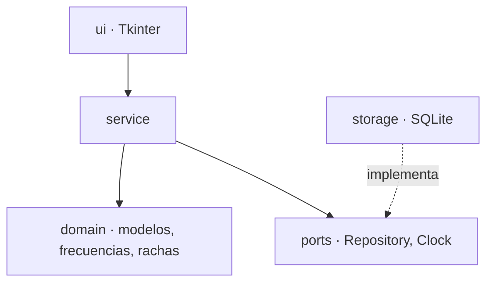

# Habit Tracker

Una app de escritorio para llevar hábitos con una idea central: **sin culpa**.
Rachas, calendario y dashboard en un diseño pastel. Python y Tkinter, sin
dependencias de ejecución. La interfaz está en español.

[Read in English](README.md)


<p align="center">
  
</p>

## Por qué existe

La mayoría de los trackers de hábitos te castigan: una racha rota en rojo, un día
"fallado" que pesa. Esta app parte de la idea contraria, y esa idea está en el código:

- Una meta flexible como "3 veces por semana" **nunca** cuenta como fallo.
- Hacer menos que la meta (3 páginas de 10) **igual cuenta** como cumplido.
- El día de hoy sin marcar **no rompe** la racha: el día todavía no terminó.

Tiene pocos hábitos a propósito: avisa antes de pasar de seis activos.

## Qué hace

| | |
|---|---|
| **Seis formas de frecuencia** | todos los días · días de la semana · N veces por semana · N veces por mes · fechas concretas · cada N días, semanas o meses |
| **Medición** | sí/no, por cantidad (páginas, vasos...) o por duración; pide el valor al marcar y lo guarda por día |
| **Rachas** | en días, en períodos cumplidos (metas semanales o mensuales) o en ocasiones seguidas (fechas e intervalos) |
| **Selector de fechas propio** | un calendario interactivo dibujado desde cero, con navegación entre meses y límites de vigencia |
| **Recordatorios** | notificaciones de macOS a la hora que elijas, una vez al día y solo si el hábito todavía no está hecho |
| **Dashboard** | porcentaje por área, dona de balance, ritmo del mes y mapa de constancia; aparece al poner la ventana en pantalla completa |
| **Edición** | clic derecho sobre un hábito para reabrirlo; su historial se conserva |
| **Tus datos, tuyos** | un archivo SQLite local; nada sale de tu equipo y la app no hace conexiones de red |

## Capturas

<table>
  <tr>
    <td align="center" width="33%"><br><sub><b>Hoy</b> · anillo de progreso, rachas y la prioridad de mañana</sub></td>
    <td align="center" width="33%"><br><sub><b>Nuevo hábito</b> · área, frecuencia y vista previa en vivo</sub></td>
    <td align="center" width="33%"><br><sub><b>Fechas concretas</b> · calendario interactivo</sub></td>
  </tr>
  <tr>
    <td align="center"><br><sub><b>Calendario</b> · un punto de color por área cumplida</sub></td>
    <td align="center"><br><sub><b>Mi mes</b> · porcentajes, balance y constancia</sub></td>
    <td align="center"><br><sub><b>Modo eliminar</b> · se elige en la misma ventana</sub></td>
  </tr>
</table>

<p align="center">
  <br>
  <sub><b>Dashboard</b> · aparece al poner la ventana en pantalla completa</sub>
</p>

## Probarla

Necesitas **Python 3.12 o superior con Tkinter** (el instalador de
[python.org](https://www.python.org/downloads/) lo incluye).

```bash
git clone https://github.com/AndJunes/habit-tracker.git
cd habit-tracker
python3 -m venv .venv
source .venv/bin/activate
python -m pip install -e .
```

Ábrela con datos de ejemplo, que viven en memoria y nunca se guardan:

```bash
python -m habit_tracker --demo
```

O úsala de verdad:

```bash
python -m habit_tracker
```

Tus datos se guardan en la carpeta de datos de usuario de tu plataforma (en
macOS, `~/Library/Application Support/com.habittracker.app/habits.sqlite3`). Con
`--data-dir DIR` los guardas en otro lugar.

### Si vienes de una versión anterior

Las versiones anteriores guardaban los datos en un archivo `habitos.json`. Para traerlos:

```bash
python -m habit_tracker --import-legacy ruta/a/habitos.json
```

El archivo se lee, nunca se modifica, y se hace una copia a su lado
(`habitos.json.bak-v3-AAAAMMDD`). Lo que no se pueda importar se omite y queda
en el registro; el resto se conserva.

## Cómo está hecha



Cada capa depende solo de las de abajo, y una prueba lo hace cumplir leyendo los
imports. El dominio no hace entrada/salida ni usa el reloj; el servicio escribe
primero en el repositorio y después en memoria, así una escritura fallida nunca
deja las dos cosas desparejas; el archivo de datos nunca se sobrescribe cuando no
se puede leer: se aparta con otro nombre y se le avisa a la persona. Los detalles,
las reglas de frecuencia y los motivos están en [docs/architecture.md](docs/architecture.md)
(en inglés).

## Desarrollo

```bash
python -m pip install -e . --group dev
pytest                  # pruebas; las gráficas se omiten, con motivo, si no hay pantalla
ruff check              # lint
ruff format --check     # formato
mypy                    # tipos
```

Mira [CONTRIBUTING.md](CONTRIBUTING.md).

En `tools/` hay dos scripts de ayuda que necesitan Pillow (`python -m pip install --group tools`):

```bash
python tools/capture_screens.py    # te guía para sacar las capturas de este README
python tools/build_macos_app.py    # crea "Registro de hábitos.app" en el Escritorio (macOS)
```

El script de capturas rechaza las de pantalla completa, para que un escritorio
nunca termine en el repositorio.

## Estado y límites

- Desarrollada y probada en **macOS**. Las carpetas de datos de Linux y Windows
  siguen la convención de cada plataforma pero no se han ejecutado.
- Los recordatorios suenan solo con la app abierta, y solo en macOS.
- La interfaz está dibujada sobre un canvas: no se puede usar con el teclado y no
  expone su contenido a lectores de pantalla.
- No hay pausar ni archivar un hábito: para retirarlo, ponle una fecha de fin (su
  historial se conserva) o elimínalo.
- Los valores registrados (páginas, minutos...) se guardan y se muestran, pero las
  estadísticas del mes cuentan días cumplidos, no cantidades.

## Licencia

[MIT](LICENSE) © 2026 Andrea Junes · [@AndJunes](https://github.com/AndJunes)
