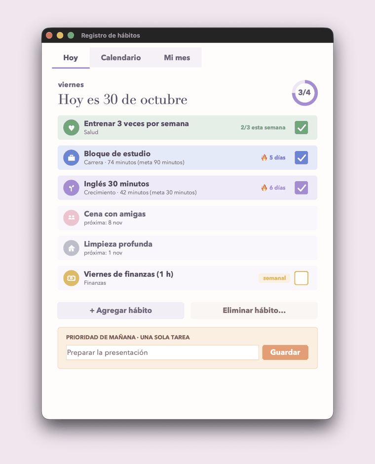
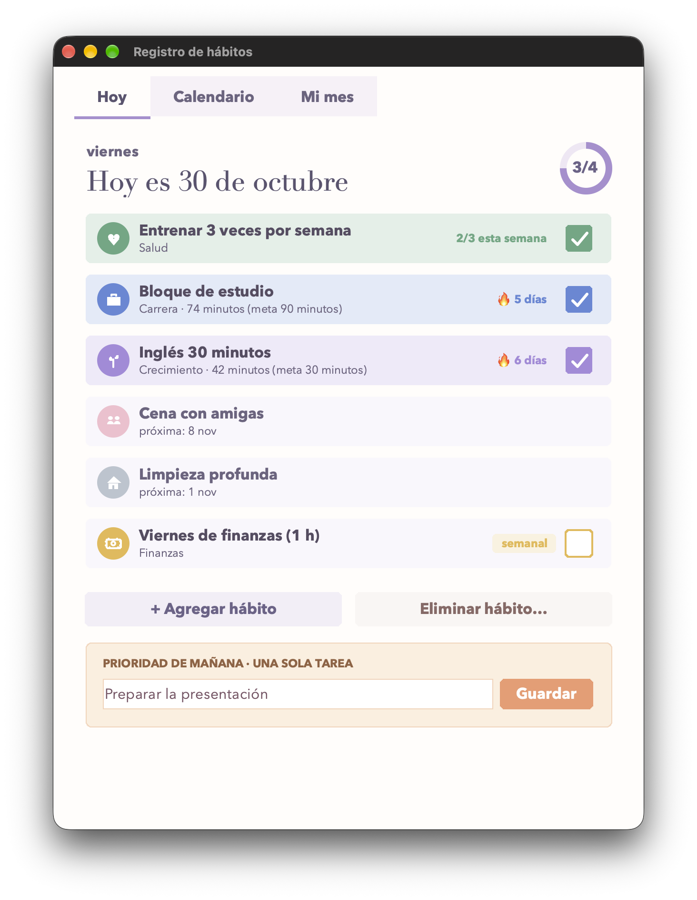
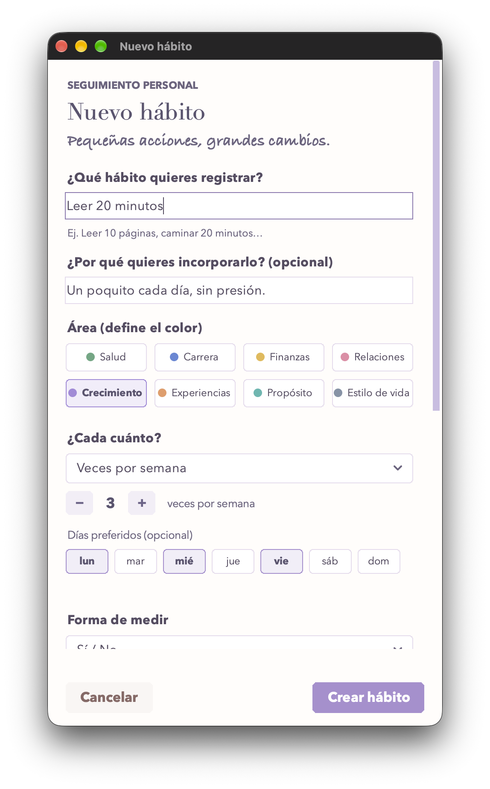
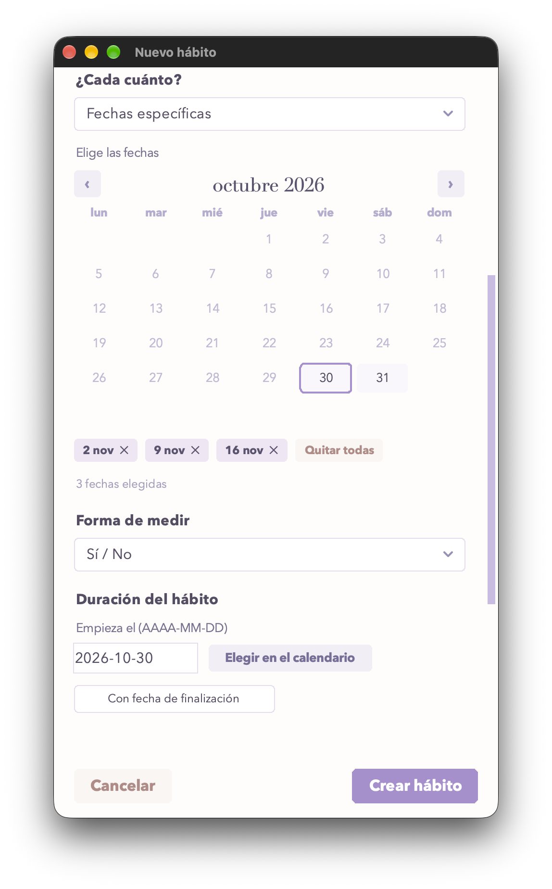
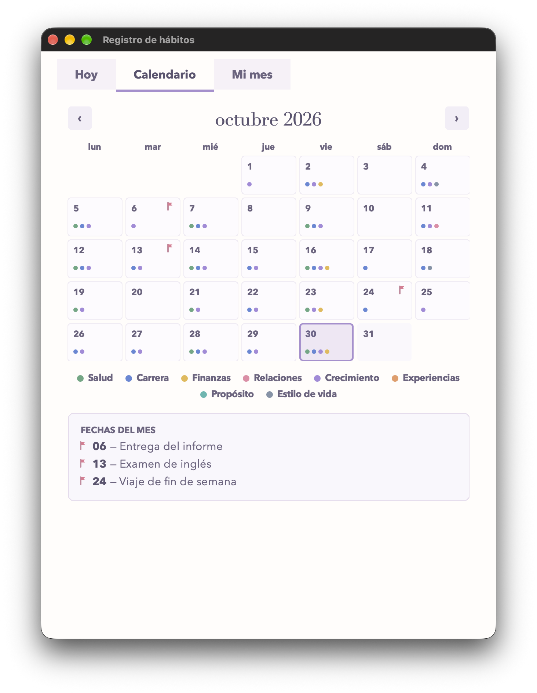
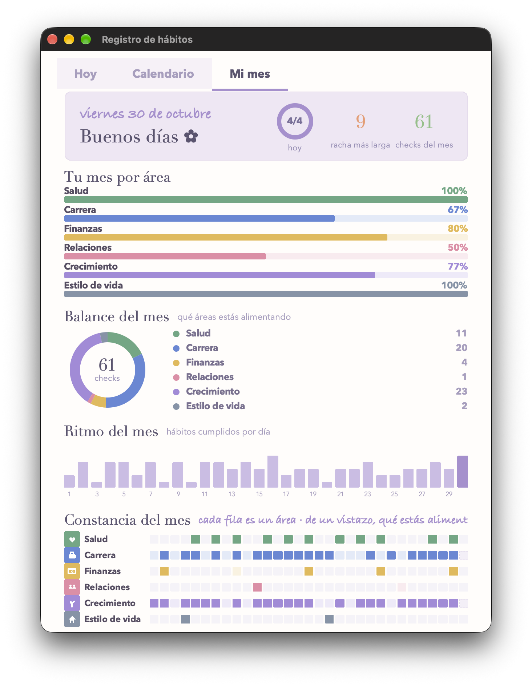
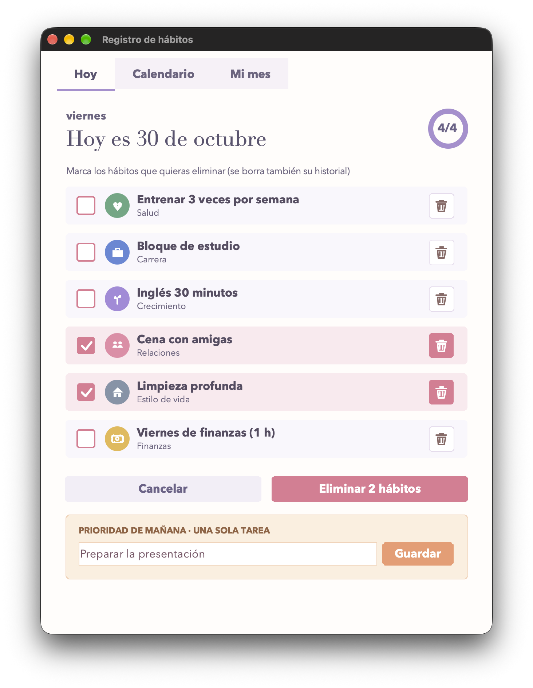
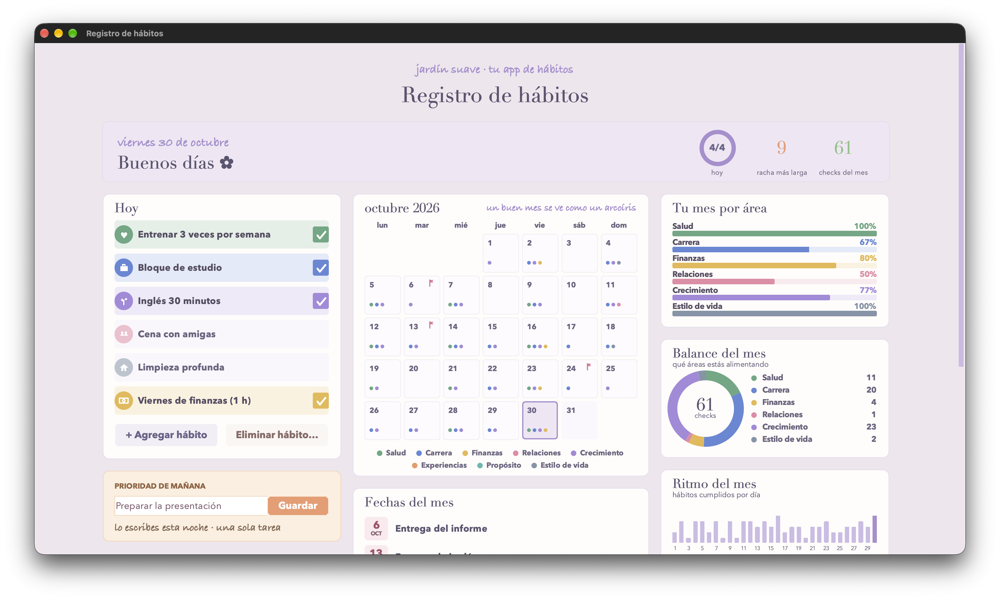
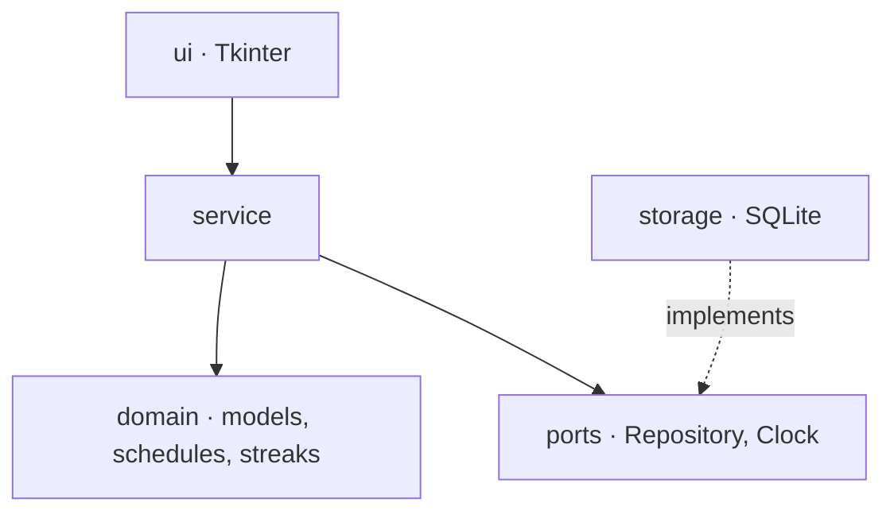

# Habit Tracker

A desktop habit tracker built around one idea: **no guilt**. Streaks, a calendar
and a dashboard in a soft pastel design. Python and Tkinter, with no runtime
dependencies. The interface is in Spanish.

[Leer en español](README.es.md)


<p align="center">
  
</p>

## Why it exists

Most habit trackers punish you: a broken streak in red, a "failed" day that
weighs. This one starts from the opposite idea, and the idea is in the code:

- A flexible goal such as "3 times per week" **never** counts as a failure.
- Doing less than the goal (3 pages out of 10) **still counts** as done.
- Today, not yet marked, **does not break** the streak: the day is not over.

It also has few habits on purpose: it warns you before you go past six active
ones.

## What it does

| | |
|---|---|
| **Six kinds of schedule** | every day · chosen weekdays · N times per week · N times per month · specific dates · every N days, weeks or months |
| **Measuring** | yes/no, by quantity (pages, glasses...) or by duration; it asks for the value when you mark the habit and stores it per day |
| **Streaks** | in days, in completed periods (for weekly or monthly goals) or in consecutive occasions (dates and intervals) |
| **Own date picker** | an interactive calendar drawn from scratch, with month navigation and limits for the habit's lifetime |
| **Reminders** | macOS notifications at the time you choose, once a day and only if the habit is not done yet |
| **Dashboard** | percentage per area, balance donut, pace of the month and a consistency map; it appears when the window is made full screen |
| **Editing** | right-click any habit to reopen it; its history is kept |
| **Your data stays yours** | one local SQLite file; nothing leaves your machine and the app makes no network requests |

## Screenshots

<table>
  <tr>
    <td align="center" width="33%"><br><sub><b>Today</b> · progress ring, streaks and tomorrow's priority</sub></td>
    <td align="center" width="33%"><br><sub><b>New habit</b> · area, schedule and a live preview</sub></td>
    <td align="center" width="33%"><br><sub><b>Specific dates</b> · interactive calendar</sub></td>
  </tr>
  <tr>
    <td align="center"><br><sub><b>Calendar</b> · one dot of color per area done</sub></td>
    <td align="center"><br><sub><b>My month</b> · percentages, balance and consistency</sub></td>
    <td align="center"><br><sub><b>Delete mode</b> · chosen in the same window</sub></td>
  </tr>
</table>

<p align="center">
  <br>
  <sub><b>Dashboard</b> · appears when the window is full screen</sub>
</p>

## Try it

You need **Python 3.12 or newer with Tkinter** (the installers from
[python.org](https://www.python.org/downloads/) include it).

```bash
git clone https://github.com/AndJunes/habit-tracker.git
cd habit-tracker
python3 -m venv .venv
source .venv/bin/activate
python -m pip install -e .
```

Open it with sample data, which are kept in memory and never saved:

```bash
python -m habit_tracker --demo
```

Or use it for real:

```bash
python -m habit_tracker
```

Your data is stored in the user data folder of your platform (on macOS,
`~/Library/Application Support/com.habittracker.app/habits.sqlite3`). Use
`--data-dir DIR` to keep it somewhere else.

### Coming from an older version

Earlier versions kept the data in a `habitos.json` file. To bring it in:

```bash
python -m habit_tracker --import-legacy path/to/habitos.json
```

The file is read, never modified, and a copy is made next to it
(`habitos.json.bak-v3-YYYYMMDD`). Entries that cannot be imported are skipped
and listed in the log; the rest is kept.

## How it is built



Each layer depends only on the ones below it, and a test enforces it by reading
the imports. The domain has no I/O and no clock; the service writes to the
repository first and to memory second, so a failed write never leaves the two
out of step; the data file is never overwritten when it cannot be read: it is
set aside under a new name and the person is told. The details, the schedule
rules and the reasons are in [docs/architecture.md](docs/architecture.md).

## Development

```bash
python -m pip install -e . --group dev
pytest                  # tests; GUI tests are skipped, with a reason, when there is no display
ruff check              # lint
ruff format --check     # formatting
mypy                    # types
```

See [CONTRIBUTING.md](CONTRIBUTING.md).

Two helper scripts live in `tools/` and need Pillow (`python -m pip install --group tools`):

```bash
python tools/capture_screens.py --auto   # captures the screenshots and builds the GIF by itself
python tools/capture_screens.py          # or guides you to take them by hand
python tools/build_macos_app.py    # creates "Registro de hábitos.app" on the Desktop (macOS)
```

With `--auto` the app opens in demo mode, goes through every screen and saves only
its own window (macOS asks once to allow the terminal to record the screen). The
manual mode refuses full-screen captures, so that a desktop never ends up in the
repository.

## Status and limits

- Developed and tested on **macOS**. The data folders for Linux and Windows
  follow each platform's convention but have not been run.
- Reminders sound only while the app is open, and only on macOS.
- The interface is drawn on a canvas: it cannot be used from the keyboard and
  does not expose its content to screen readers.
- There is no pause or archive for a habit: to retire one, give it an end date
  (its history is kept) or delete it.
- Recorded values (pages, minutes...) are stored and shown, but the monthly
  statistics count done days, not amounts.

## License

[MIT](LICENSE) © 2026 Andrea Junes · [@AndJunes](https://github.com/AndJunes)
