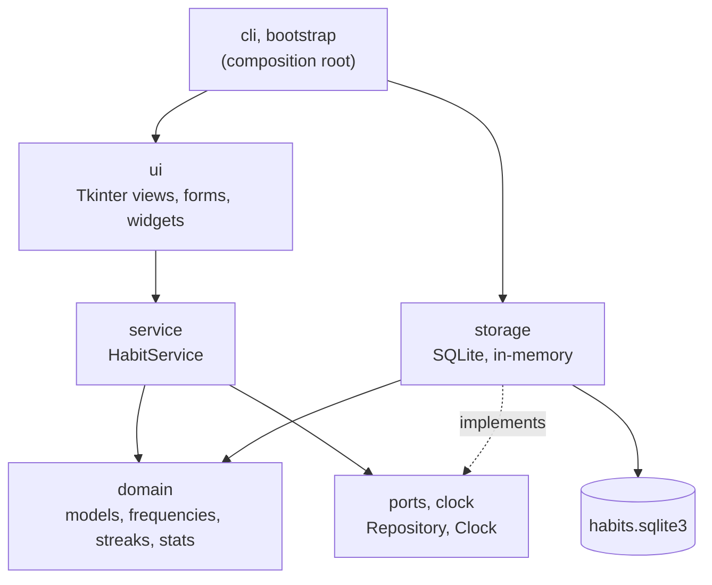

# Architecture

Habit Tracker is a desktop application written in Python with Tkinter, with no
runtime dependencies. The code is split in layers so that the rules of the
product can be tested without a window and the data store can be replaced
without touching them.

## The rule

Each layer depends only on the ones below it, and this is enforced by a test
(`tests/unit/test_architecture.py`) that reads the imports of every module:

| Part | May import | Never imports |
|---|---|---|
| `domain` | itself | everything else |
| `ports`, `clock` | `domain` | storage, service, ui |
| `service` | `domain`, `ports`, `clock` | storage, ui |
| `storage` | `domain`, `ports`, `clock`, `paths` | service, ui |
| `ui` | `domain`, `ports`, `clock`, `service`, `notifications` | storage, bootstrap |

Only `ui` imports `tkinter`. The composition root (`bootstrap`, `cli`, `demo`,
`seed`) is the one place that knows which repository is used.

## Domain

Plain data and rules, with no I/O and no clock.

- **Models** (`domain/models.py`): `Habit`, `Area`, `Measurement`, `Reminder`,
  `ImportantDate`, `PriorityNote`. `Habit.completions` maps each completed day
  to the value that was measured (or `None` for yes/no habits): it is the single
  source of truth for "done". A value below the goal still counts, because goals
  guide and never judge.
- **Frequencies** (`domain/frequency.py`): five value types (`Daily`,
  `Weekdays`, `Quota`, `FixedDates`, `Interval`). Their constructors validate
  their data. Each answers three questions: is a habit that starts on a given
  day due on another day, which is the latest due day on or before a day, and
  which is the first due day after it. Fixed dates use `bisect`; intervals use
  calendar arithmetic, so a habit that starts on the 31st is due on January 31,
  February 28 and March 31 without drifting.
- **Streaks, statistics, reminders** (`streaks.py`, `stats.py`, `reminders.py`):
  pure functions of a habit and a day.
- **Errors** (`domain/errors.py`): `ValidationError` carries a stable
  `ErrorCode`; the interface turns codes into Spanish sentences, so the domain
  never contains user-facing text.

### "No guilt" is a rule of the model

- A quota ("3 times per week") never produces a missed day and never lowers a
  percentage: it can only add.
- A day that is not over yet is "pending", not "missed", and a pending day never
  breaks a streak.
- What the person scheduled explicitly (a date, an interval, fixed weekdays)
  does count as missed when it passes without being done.

| Frequency | Due on | Streak counts | Can be missed |
|---|---|---|---|
| Daily, weekdays | the matching days | consecutive due days | yes |
| Quota | any day | consecutive periods with the quota met | never |
| Fixed dates | exactly those dates | consecutive occasions | yes |
| Interval | every N days, weeks or months from the start | consecutive occurrences | yes |

## Service and ports

`HabitService` is the only thing the interface talks to. It keeps the data in
memory, applies the domain rules, and writes every change through the
`Repository` protocol **first**: if the store fails, the memory is left as it
was. The clock is injected (`Clock`), so everything that depends on "today" is
testable.

## Storage

`SqliteRepository` implements `Repository` with the standard library only.

- One public method is one transaction. Values are always bound parameters.
- The schema version lives in `PRAGMA user_version`, and `PRAGMA application_id`
  marks the file as ours, so another program's database is never "migrated".
  Migrations are an ordered chain, one step per version, each run in its own
  transaction together with the version bump. A database from a newer version is
  refused without writing anything.
- Tables: `areas`, `habits` (the frequency is a `kind` plus a JSON object of
  parameters; measurement and reminder are nullable columns with `CHECK`s),
  `completions` (cascade-deleted with their habit), `important_dates` and
  `priority_note`. Dates are `YYYY-MM-DD` text.
- **Recovery** (`storage/recovery.py`): a file SQLite cannot read as a database
  is never deleted. It is moved next to where it was as
  `habits.sqlite3.corrupt-YYYYMMDD-HHMMSS`, a fresh database takes its place and
  the interface tells the person. Healthy files that cannot be used here (another
  program's, or a newer version's) are left untouched.
- **Legacy import** (`storage/legacy_json.py`): reads the JSON files written by
  versions 1 to 3 of the application. A bad entry is skipped and reported, never
  fatal, and the original file is not modified.
- **Where the data lives** (`paths.py`): macOS
  `~/Library/Application Support/com.habittracker.app`, Linux
  `$XDG_DATA_HOME/habit-tracker` (default `~/.local/share`), Windows
  `%LOCALAPPDATA%\HabitTracker`. The directory is created readable only by its
  owner. `--data-dir` overrides it.
- `MemoryRepository` implements the same protocol for tests and for `--demo`. A
  contract test runs the same checks against both implementations.

## Interface

Everything is drawn on `tkinter.Canvas`, because Tkinter has no rounded corners,
progress rings or themeable menus on macOS.

- `ui/theme`: palette, fonts (one registry per Tk root), drawing helpers, and the
  platform cursor.
- `ui/widgets`: `SoftButton`, `TrashButton`, `SoftMenu`, `SelectionChip`,
  `SoftScrollbar`, `DatePicker`.
- `ui/views`: Today, Calendar, Month and the full-screen Dashboard;
  `ui/controllers` holds what Today and the Dashboard share (marking, editing,
  delete mode, the priority note).
- `ui/forms`: the habit form. What the person picks lives in `FormState`, which
  has no Tk in it and is tested without a window; the widgets only render it.
- **A menu without a grab.** On macOS a Tk grab swallows clicks from outside
  without telling anyone, which left the open list stuck. `SoftMenu` borrows the
  dialog's modality while it is open and listens for outside clicks through one
  global click dispatcher per window.

## Keyboard focus

A canvas is not in the Tab order unless it asks for it, so `ui/theme/focus.py`
holds the three pieces every drawn control uses: `track_focus` (take part in the
Tab order and say whether the keyboard has the focus), `focus_ring` (the ring,
drawn only then) and `activate_with_keys` (Space and Enter do what a click
does). A click never focuses a canvas, so the ring appears only for the
keyboard.

- Rows of the "Today" tab are canvases of their own and take the focus directly.
  The dashboard draws its rows as items of one canvas, and items cannot take the
  focus, so each row has a one-pixel anchor canvas, painted like the row, that
  stands in for it in the Tab order.
- Both lists redraw from scratch; `FocusMemory` puts the focus back on the same
  control of the same habit afterwards.
- The three views share one grid cell. The ones not shown leave the grid, so Tab
  never reaches a control that cannot be seen.
- An open `SoftMenu` list never takes the focus: the field keeps it and moves a
  highlight with the arrow keys. In the habit form, Escape closes the list
  first and the dialog on the next press.
- The habit form scrolls to keep the focused field in view.

Text colors are checked against every surface they are drawn on
(`tests/unit/ui/test_contrast.py`, WCAG 2.2 formula, 4.5 : 1); the focus ring
color reaches 3 : 1 on all of them.

## Testing

- `tests/unit`: no window needed. Domain, service, storage, the architecture
  rules, and the pure parts of the interface (`FormState`, texts).
- `tests/gui`: need a display; when there is none they are skipped with a
  visible reason, never reported as passed.
- A contract test shared by both repositories.

## Known limits

- The interface is drawn on a canvas. It is reachable by keyboard (see below)
  but does not expose its content to screen readers.
- Reminders sound only while the application is open, and only on macOS.
- Only macOS is tested. The platform data directories for Linux and Windows
  follow the platforms' conventions but have not been run.
